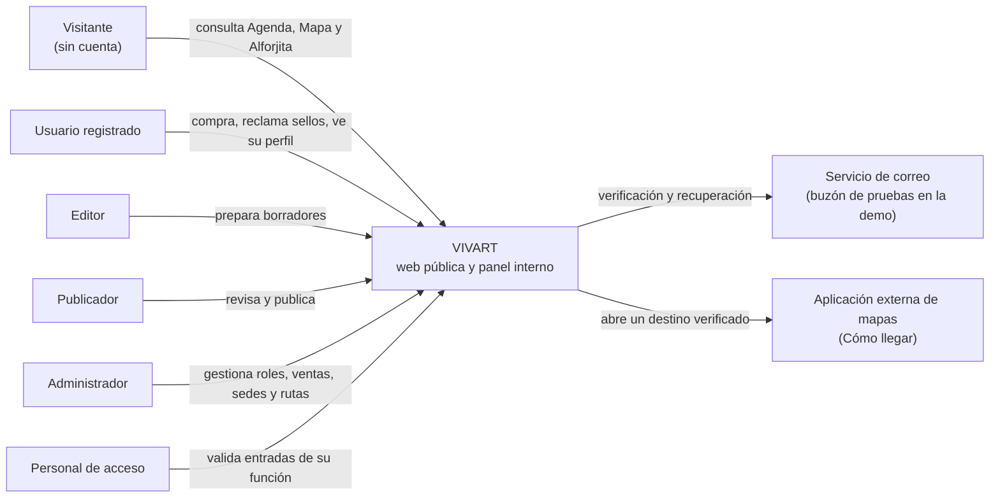

# Vista 1: Contexto

Propuesta del equipo, pendiente de contrastar con la nomenclatura que pida el docente.

Muestra VIVART como una sola caja frente a las personas que lo usan y los sistemas externos con los que se comunica.

## Qué muestra

- **Seis roles** (RC-01). Una persona puede tener varios.
- **Sistemas externos:** el correo (verificación y recuperación, RF-02) y una aplicación de mapas a la que solo se entrega un destino verificado (RF-13). En la demo no se envían correos reales (FR-030 del spec 001).
- **Lo que no hay:** VIVART no procesa pagos reales ni datos de tarjeta (RNF-05).
