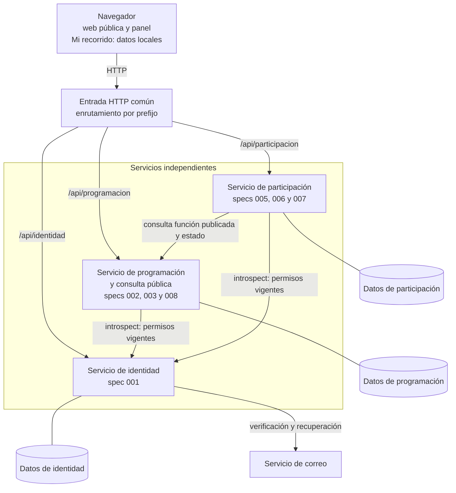

# Vista 2: Contenedores o servicios

Propuesta del equipo, pendiente de contrastar con la nomenclatura que pida el docente.

Muestra las piezas que se despliegan y cómo se comunican: llamadas HTTP síncronas, sin broker de eventos.

## Responsabilidades

| Servicio | Dueño de | Consulta a |
|---|---|---|
| Identidad | Cuentas, sesiones, roles, asignación de funciones, historial de permisos | Correo |
| Programación y consulta pública | Actividades, funciones, franjas, borradores, categorías, sedes, datos del mapa; Alforjita lee el catálogo publicado | Identidad (permisos) |
| Participación | Cupos, pedidos, entradas, QR y sellos, rutas, progreso, insignias | Identidad (permisos), Programación (función publicada y estado) |

## Reglas de las flechas

- Toda flecha entre servicios es una **llamada HTTP síncrona** a la API del otro servicio. Ningún servicio lee ni escribe las tablas de otro.
- Si el servicio de identidad no responde, las operaciones protegidas **no se autorizan** y la consulta pública sigue disponible.
- Mi recorrido (spec 004) no tiene servicio: su estado vive en el navegador y consulta a Programación.
- Los flujos de cupo (spec 005) y de sello (spec 006) están dentro del servicio de participación y se describen en la vista de comportamiento; no están implementados todavía.
