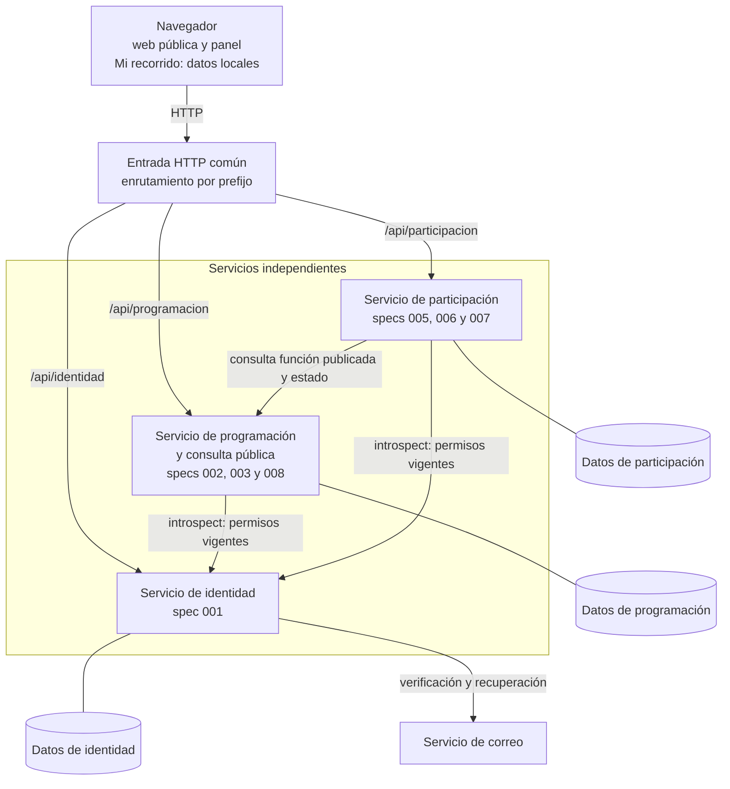

# Vista 2: Contenedores o servicios

Propuesta del equipo, pendiente de contrastar con la nomenclatura que pida el docente.

Muestra las piezas que se despliegan y cómo se comunican: llamadas HTTP síncronas, sin broker de eventos.

## Responsabilidades

| Servicio | Dueño de | Consulta a |
|---|---|---|
| Identidad | Cuentas, sesiones, roles, asignación de funciones, historial de permisos | Correo |
| Programación y consulta pública | Actividades, funciones, franjas, borradores, categorías, sedes, datos del mapa; Alforjita lee el catálogo publicado | Identidad (permisos) |
| Participación | Cupos, pedidos, entradas, QR y sellos, rutas, progreso, insignias | Identidad (permisos), Programación (función publicada y estado) |

## Reglas de las flechas

- Toda flecha entre servicios es una **llamada HTTP síncrona** a la API del otro servicio. Ningún servicio lee ni escribe las tablas de otro.
- Si el servicio de identidad no responde, las operaciones protegidas **no se autorizan** y la consulta pública sigue disponible.
- Mi recorrido (spec 004) no tiene servicio: su estado vive en el navegador y consulta a Programación.
- Los flujos de cupo (spec 005) y de sello (spec 006) están dentro del servicio de participación y se describen en la vista de comportamiento. Los dos están implementados.
- Participación consulta a programación el estado vigente de cada función al vender y al validar, y programación le pide el impacto en entradas antes de reprogramar o cancelar: dos llamadas HTTP en sentidos opuestos, sin datos compartidos.

## Estado de implementación

| Servicio | Estado | Contrato |
|---|---|---|
| Identidad | Implementado (spec 001) | `specs/001-identidad-y-permisos/contracts/` |
| Programación y consulta pública | Implementado el spec 002 (Agenda, ficha, «¿Qué hay ahora?», flujo editorial, cambios con aviso, carga, catálogos y archivo) y el spec 003 (mapa de sedes: marcadores sobre la ilustración, búsqueda, «Funciones del día», accesibilidad verificada, destino de «Cómo llegar» y foto de la sede), con su interfaz | `specs/002-programacion-y-publicacion/contracts/` y `specs/003-mapa-de-sedes/contracts/` |
| Participación | Implementado el spec 005 (carrito, pedidos con retención, pago de prueba, entradas con QR, control de acceso y administración de la venta), el spec 006 (QR del Pasaporte por función, canje con sello único, colección y contenido versionado del sello) y el spec 007 (rutas culturales, cálculo dinámico «Ruta en revisión», progreso con denominador propio y desbloqueo atómico de insignias) | `specs/005-compra-y-entradas/contracts/`, `specs/006-pasaporte-y-sellos/contracts/` y `specs/007-rutas-e-insignias/contracts/` |

Programación ofrece a participación `GET /internal/functions/{id}` y `GET /internal/functions?ids=` (con credencial de servicio), y pide a participación `GET /internal/functions/{id}/impact` antes de reprogramar o cancelar. Si participación no responde, el impacto se informa como «no disponible» y solo el administrador puede cancelar.
