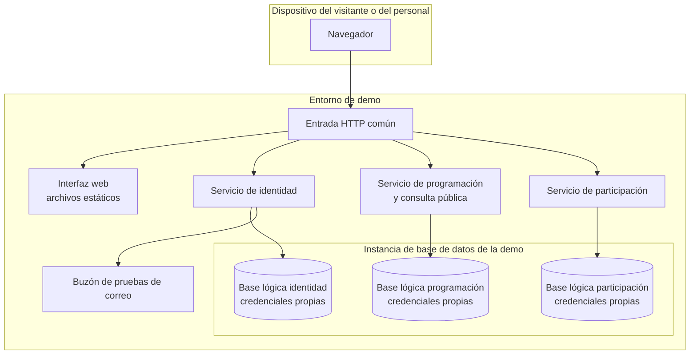

# Vista 3: Despliegue

Propuesta del equipo, pendiente de contrastar con la nomenclatura que pida el docente.

Muestra qué unidades se despliegan por separado y dónde viven los datos en la demo.

## Qué se despliega y cómo

| Unidad | Despliegue | Datos |
|---|---|---|
| Entrada HTTP común | Independiente | Ninguno |
| Interfaz web | Independiente | Ninguno (Mi recorrido usa el almacenamiento del navegador) |
| Servicio de identidad | Independiente | Base lógica propia |
| Servicio de programación | Independiente | Base lógica propia |
| Servicio de participación | Independiente | Base lógica propia |
| Buzón de pruebas | Solo en demo y pruebas | Mensajes de prueba, nunca correos reales |

## Reglas

- Las tres bases lógicas pueden vivir en **una misma instancia** en la demo, pero cada servicio usa **credenciales propias** y **no escribe** en la base de otro.
- Un servicio se puede publicar sin volver a desplegar los demás, siempre que respete los contratos de las APIs.
- En el MVP el servicio de identidad puede usar un archivo de base de datos propio (por ejemplo, SQLite) en lugar de una instancia compartida; es una decisión técnica reversible y no cambia esta vista.
- No hay gateway dedicado, broker de eventos ni malla de servicios.
