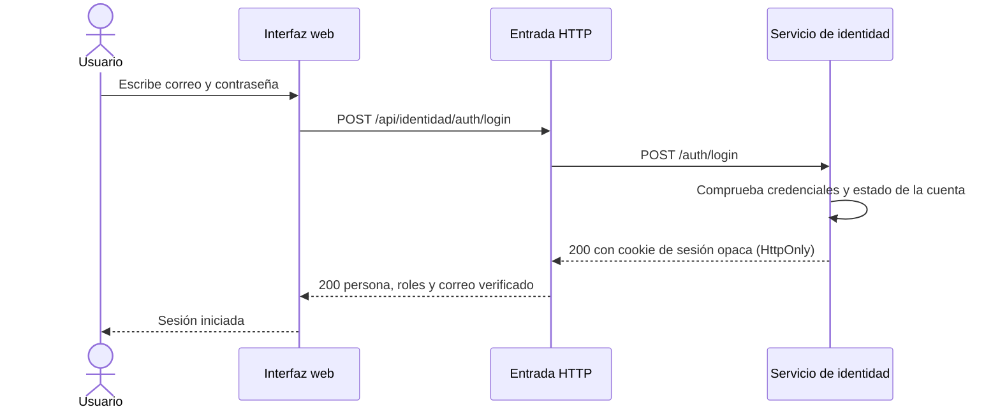
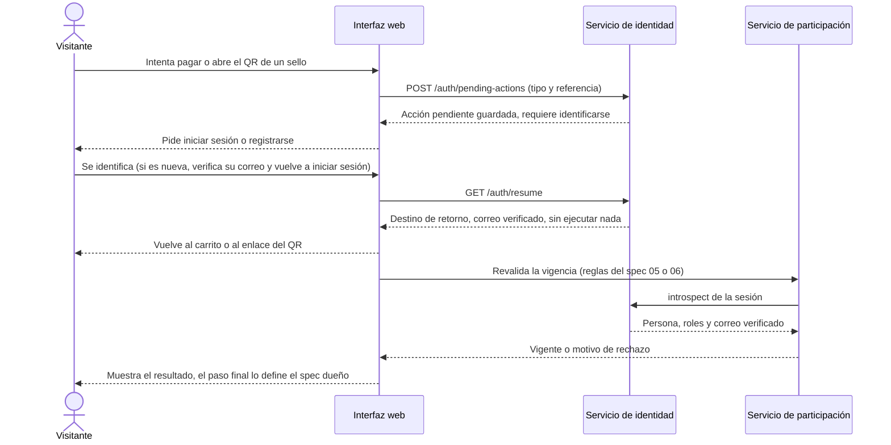
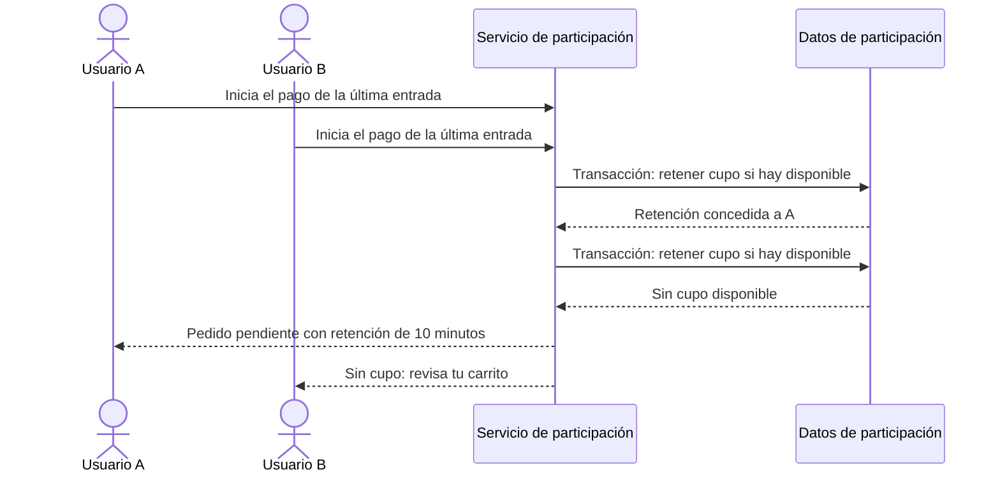
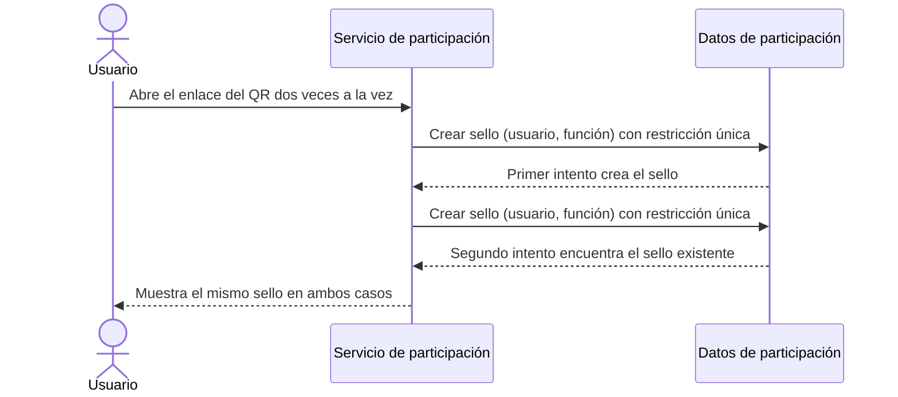
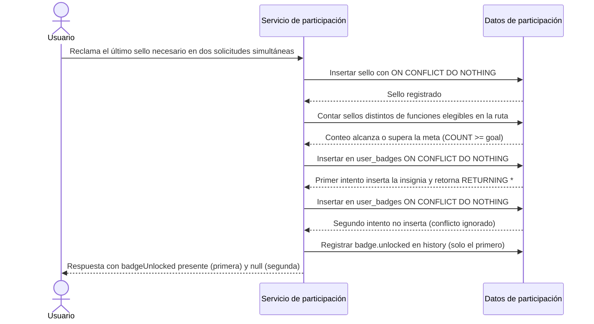

# Vista 4: Comportamiento

Propuesta del equipo, pendiente de contrastar con la nomenclatura que pida el docente.

Muestra los flujos críticos entre piezas. Los dos primeros son del spec 001, el tercero del spec 005, el cuarto del spec 006 y el quinto del spec 007, todos implementados.

## 1. Inicio de sesión (spec 001)

## 2. Retorno a la acción original tras identificarse (spec 001)

El servicio de identidad conserva la acción pendiente y devuelve a la persona al punto de origen. **No ejecuta el pago ni el canje**: el servicio dueño revalida y define qué ocurre después.

## 3. Retención y venta del último cupo (spec 005)

Implementado con un bloqueo de la fila de venta de cada función (`SELECT … FOR UPDATE`) dentro de la transacción que crea el pedido; probado con veinte solicitudes simultáneas.

## 4. Canje de un sello único (spec 006)

Implementado con la restricción única `(user_id, function_id)` de la tabla `stamps` y una inserción `ON CONFLICT DO NOTHING`; probado con veinte solicitudes simultáneas. Antes de emitir, participación consulta la función vigente a programación: si cambió de fecha, hora o sede desde que se confirmó la ventana, el canje queda desactivado (P-03), sin avisos entre servicios.

## 5. Desbloqueo concurrente de insignias por ruta (spec 007)

Implementado con la restricción única `(user_id, route_id)` de la tabla `user_badges` y una inserción `ON CONFLICT (user_id, route_id) DO NOTHING RETURNING *`.
Al canjear el sello que alcanza la meta de una ruta, el servicio evalúa de forma atómica si corresponde desbloquear la insignia. Si varias peticiones concurrentes completan la meta simultáneamente, exactamente una logra la inserción, registra el evento en `history` y retorna `badgeUnlocked` en la respuesta JSON; las demás retornan `badgeUnlocked: null` sin duplicar filas ni eventos.

