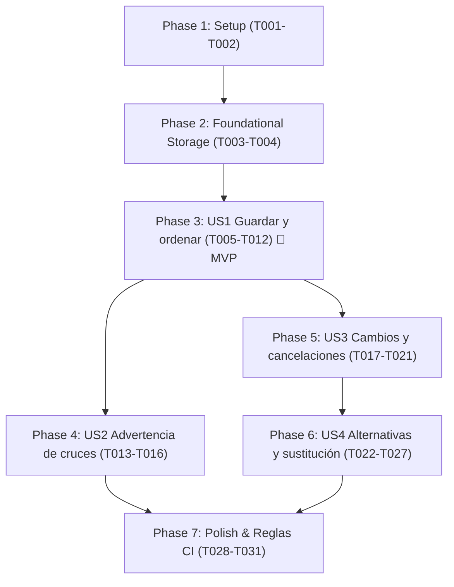

# Tasks: Mi recorrido y alternativas

**Input**: Design documents from `specs/004-mi-recorrido/`

**Prerequisites**: plan.md, spec.md, research.md, data-model.md, contracts/, quickstart.md

**Tests**: Sí. Se incluye una suite de pruebas unitarias (`app/web/test/recorrido.test.js`) con `node:test` para validar la lógica de almacenamiento, cruces, ordenamiento cronológico y alternativas.

**Organization**: Por fases y agrupado por historia de usuario. Rutas relativas a la raíz del repositorio; `W/` = `app/web/`.

## Format: `[ID] [P?] [Story] Description`

- **[P]**: Tarea paralelizable (archivos distintos, sin dependencias pendientes).
- **[Story]**: Historia de usuario a la que pertenece (US1, US2, US3, US4).
- Cada tarea incluye la ruta exacta del archivo afectado.

---

## Phase 1: Setup

- [x] T001 [P] Crear el archivo de pruebas unitarias `W/test/recorrido.test.js` con el ejecutor nativo `node:test` y `node:assert`, configurando mocks mínimos para `localStorage` y entorno de ejecución.
- [x] T002 Verificar que `npm test` en `app/` ejecute las pruebas de frontend de `W/test/` junto a las suites existentes de los servicios.

---

## Phase 2: Foundational

- [x] T003 [P] Crear `W/js/recorrido.js` con la estructura de almacenamiento `vivart_recorrido_v1` citando `data-model.md` (`ItemRecorrido.id`, `ItemRecorrido.kind`, `ItemRecorrido.status`, `ItemRecorrido.date`, `ItemRecorrido.startTime`), implementando funciones base para lectura/escritura segura con manejo de excepciones (storage bloqueado, cuota excedida o JSON corrupto).
- [x] T004 [P] Pruebas unitarias de persistencia base en `W/test/recorrido.test.js`: inicialización vacía, persistencia en `localStorage`, lectura segura ante corrupción y vaciado de recorrido (SC-001, SC-008).

---

## Phase 3: User Story 1 - Guardar y ordenar mi recorrido (Priority: P1) 🎯 MVP

**Goal**: Un visitante guarda funciones o franjas desde la Agenda o desde la ficha de actividad, las quita y las ve ordenadas cronológicamente en `/recorrido` sin cuenta.

**Independent Test**: Sin iniciar sesión, guardar 3 funciones desde la ficha o agenda, cerrar y reabrir el navegador, y verificar que permanecen guardadas y ordenadas por fecha y hora de inicio.

### Tests para User Story 1

- [x] T005 [P] [US1] Pruebas unitarias en `W/test/recorrido.test.js`: ordenamiento cronológico de funciones y franjas por `date` ascendente y `startTime` ascendente, guardado idempotente (sin duplicar `id`), eliminación individual y verificación de pertenencia (`estaEnRecorrido`) (SC-001, SC-002).

### Implementación para User Story 1

- [x] T006 [US1] Implementar en `W/js/recorrido.js` las funciones públicas de gestión: `guardarEnRecorrido(item)`, `quitarDeRecorrido(id)`, `estaEnRecorrido(id)` y `obtenerRecorrido()`, formateando el snapshot completo de la función o franja según `data-model.md` (`ItemRecorrido`).
- [x] T007 [US1] Crear la función `pantallaRecorrido()` en `W/js/recorrido.js`: renderizado de la lista cronológica agrupada por fecha, tarjetas de función/franja con horarios, artistas, sede, botón «Quitar», y aviso destacado de que *«Guardar no reserva cupo»* (FR-003).
- [x] T008 [US1] Implementar en `pantallaRecorrido()` el estado vacío accesible cuando no hay funciones guardadas, con mensaje explicativo y botón para «Explorar la Agenda» (`/agenda`).
- [x] T009 [US1] Registrar la ruta `/recorrido` en `W/app.js` (enrutador `resolverRuta`) y agregar el enlace correspondiente a «Mi recorrido» en la navegación de la cabecera (`pintarNavegacion`).
- [x] T010 [US1] Añadir botón interactivo «Guardar en mi recorrido» / «Quitar de mi recorrido» en `W/js/ficha-componente.js` (junto a cada función y franja individual) con la leyenda visible «Guardar no reserva cupo» (FR-001, FR-003).
- [x] T011 [US1] Añadir botón «Guardar en mi recorrido» en las tarjetas de la Agenda en `W/js/publico.js` (para actividades con función unívoca) y enlace/botón destacado de acceso a «Mi recorrido» en la cabecera de la Agenda (FR-005).
- [x] T012 [P] [US1] Estilos en `W/styles.css` para la vista de `/recorrido`, tarjetas de función guardada, botones de acción (guardar/quitar) y leyenda de cupo, respetando la paleta violeta (`#3b0f66`), atardecer y tipografías oficiales.

**Checkpoint**: User Story 1 funcional de forma independiente: se pueden guardar, quitar y consultar funciones ordenadas sin sesión en `/recorrido`.

---

## Phase 4: User Story 2 - Advertencia de cruces (Priority: P1)

**Goal**: Cuando dos funciones o franjas guardadas se solapan en la misma fecha y ambos intervalos se conocen, Mi recorrido lo advierte visualmente sin impedir guardarlas ni bloquear al visitante.

**Independent Test**: Guardar dos funciones que se solapan en horario en la misma fecha y una tercera con hora de fin desconocida; comprobar que solo se advierte el primer par y que ambas pueden guardarse y mantenerse.

### Tests para User Story 2

- [x] T013 [P] [US2] Pruebas unitarias en `W/test/recorrido.test.js` para `detectarCruces`: par en la misma fecha con solapamiento estricto (`inicioA < finB && inicioB < finA`), funciones consecutivas tangentes (`finA == inicioB`, no cruce), funciones en fechas distintas (no cruce), y función sin fin ni duración conocida (no cruce) citando `data-model.md` (`CruceHorario`) (SC-003, SC-004, RC-02, FR-006 a FR-008).

### Implementación para User Story 2

- [x] T014 [US2] Implementar en `W/js/recorrido.js` la función `detectarCruces(items)` con la lógica estricta de solapamiento en minutos y pares de elementos en conflicto citando `data-model.md` (`CruceHorario`).
- [x] T015 [US2] Renderizar la advertencia visual de cruces en `pantallaRecorrido` en `W/js/recorrido.js`: cartel no bloqueante sobre cada tarjeta en conflicto indicando la función con la que se cruza y el intervalo de solapamiento, sin deshabilitar ninguna acción (FR-007, RC-02).
- [x] T016 [P] [US2] Estilos en `W/styles.css` para las alertas visuales de cruce (insignia de aviso, borde de advertencia en contraste accesible según RNF-03).

**Checkpoint**: User Story 2 completa: advertencias automáticas de cruces calculadas sin bloquear el flujo.

---

## Phase 5: User Story 3 - Cambios y cancelaciones reflejados (Priority: P1)

**Goal**: Si una función guardada cambia de hora o sede, Mi recorrido refleja los nuevos datos; si se cancela o archiva, permanece visible con su aviso hasta que el visitante la quite.

**Independent Test**: Guardar una función, reprogramar otra en el panel editorial y cancelar una tercera; abrir `/recorrido` y verificar que se reflejan las horas nuevas y los avisos de reprogramación y cancelación.

### Tests para User Story 3

- [x] T017 [P] [US3] Pruebas unitarias en `W/test/recorrido.test.js` para `sincronizarRecorrido`: actualización de hora y sede reflejando aviso `Notice.text`, retención de funciones canceladas con etiqueta «Cancelada», y retención de actividades archivadas (simulando 404 en API) con estado `archived` citando `data-model.md` (`ItemRecorrido.status`) (SC-005, SC-009, FR-009, FR-010, FR-018).

### Implementación para User Story 3

- [x] T018 [US3] Implementar en `W/js/recorrido.js` la función `sincronizarRecorrido(items, agenda, saleStatuses)` que contrasta el recorrido local con `/api/programacion/agenda` y actualiza horas, sedes, avisos de reprogramación y cancelaciones (FR-009, FR-010, FR-011).
- [x] T019 [US3] Manejo de funciones archivadas en `W/js/recorrido.js`: si una actividad guardada ya no aparece en la Agenda ni en la API pública, conservar el snapshot local marcándola como archivada y mostrando el distintivo *«Ya no está en la programación activa»* (y su aviso si fue cancelada) hasta que el usuario la elimine (FR-018, SC-009).
- [x] T020 [US3] Recalcular automáticamente los cruces de horario al sincronizar cuando cambie la hora de una función guardada (FR-011).
- [x] T021 [P] [US3] Estilos en `W/styles.css` para etiquetas de estado («Cancelada», «Reprogramada», «Ya no está en la programación activa») y cajas de avisos públicos en las tarjetas del recorrido.

**Checkpoint**: User Story 3 completa: sincronización transparente y trazabilidad de cambios y cancelaciones.

---

## Phase 6: User Story 4 - Alternativas cuando algo falla (Priority: P2)

**Goal**: Ante una función cancelada, agotada, terminada o con hora de inicio pasada, Mi recorrido ofrece funciones de la misma sede que aún no comiencen, permitiendo sustituir o conservar ambas.

**Independent Test**: Para una función cancelada y otra agotada en el Teatro Bolívar, abrir alternativas y comprobar que solo sugiere funciones futuras de esa misma sede y permite sustituirla en un solo clic.

### Tests para User Story 4

- [x] T022 [P] [US4] Pruebas unitarias en `W/test/recorrido.test.js`: `buscarAlternativas` (solo misma sede `venue.id`, no canceladas, hora de inicio posterior a `reference.now`), «Hora de inicio pasada» para funciones sin fin conocido (RC-03, SC-007), detección de `sold_out` vía `/sale-status` (SC-010), y sustitución atómica `sustituirEnRecorrido` (SC-011) citando `data-model.md` (`AlternativaItem`).

### Implementación para User Story 4

- [x] T023 [US4] Implementar en `W/js/recorrido.js` la consulta a `GET /api/participacion/sale-status?functionIds=...` con tolerancia a fallos (degradación suave si el servicio de venta falla o responde error) para marcar funciones con cupo agotado (`sold_out`) (FR-019, SC-010).
- [x] T024 [US4] Implementar en `W/js/recorrido.js` la función `buscarAlternativas(itemAfectado, itemsAgenda, referencia)` filtrando estrictamente por `venue.id`, funciones no canceladas y futuras en hora de Loja (FR-012, FR-013, FR-014, FR-017).
- [x] T025 [US4] Implementar en `W/js/recorrido.js` la función `sustituirEnRecorrido(idOriginal, nuevoItem)` que atómicamente quita el ítem afectado y guarda la alternativa elegida en `localStorage` (FR-015, FR-021, SC-011).
- [x] T026 [US4] Crear el componente visual de alternativas en `W/js/recorrido.js`: botón «Ver alternativas en esta sede» en funciones canceladas, agotadas o con inicio pasado, panel modal/desplegable con la lista de alternativas, botones «Sustituir» y «Conservar ambas», y mensaje de sin alternativas con botón para volver a la Agenda (FR-013, FR-015, FR-021).
- [x] T027 [P] [US4] Estilos en `W/styles.css` para el panel de alternativas, botones de sustitución y tarjeta de función agotada.

**Checkpoint**: User Story 4 completa: recomposición guiada del recorrido ante imprevistos.

---

## Phase 7: Polish & Cross-Cutting Concerns

- [x] T028 [P] Auditoría de accesibilidad y navegación por teclado en `W/js/recorrido.js`: foco visible, orden de tabulación, etiquetas `aria-label` en botones de acción y región `aria-live` para avisos de cruce y guardado (RNF-01, RNF-03).
- [x] T029 Verificación de diseño responsivo adaptativo en viewport móvil estrecho (360 px) sin desbordamiento horizontal y en escritorio (1440 px) (RNF-01).
- [x] T030 Ejecución de la suite completa de pruebas locales (`npm test`) y comprobación de las reglas del equipo con `.github/scripts/verificar-reglas.sh`.
- [x] T031 Validación manual de punta a punta en el navegador siguiendo todos los escenarios de `quickstart.md`.

---

## Dependencies & Order of Execution

### Parallel Execution Opportunities
- **Fase 1**: T001 y T002 son independientes.
- **Fase 2**: T003 y T004 pueden escribirse en paralelo.
- **Fase 3**: T005 (pruebas) y T012 (estilos CSS) son paralelizables con la lógica de UI T007-T011.
- **Fase 4**: T013 (pruebas) y T016 (estilos CSS) son paralelizables con T014-T015.
- **Fase 5**: T017 (pruebas) y T021 (estilos CSS) son paralelizables con T018-T020.
- **Fase 6**: T022 (pruebas) y T027 (estilos CSS) son paralelizables con T023-T026.
- **Fase 7**: T028 y T029 pueden ejecutarse en paralelo.

---

## Implementation Strategy

1. **MVP Incremental**: El MVP se entrega al completar la **Fase 3 (User Story 1)**: guardar funciones/franjas, ordenarlas cronológicamente, persistir en `localStorage` y verlas en `/recorrido`.
2. **Incremento 2**: La **Fase 4 (User Story 2)** añade el valor crítico de avisar cruces de horarios sin bloquear al usuario.
3. **Incremento 3**: La **Fase 5 (User Story 3)** añade la reactividad ante cambios, cancelaciones y actividades archivadas del festival.
4. **Incremento 4**: La **Fase 6 (User Story 4)** cierra el ciclo permitiendo recomponer el plan con alternativas en la misma sede ante funciones canceladas o agotadas.
