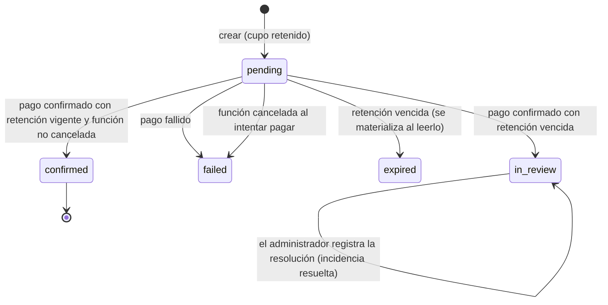
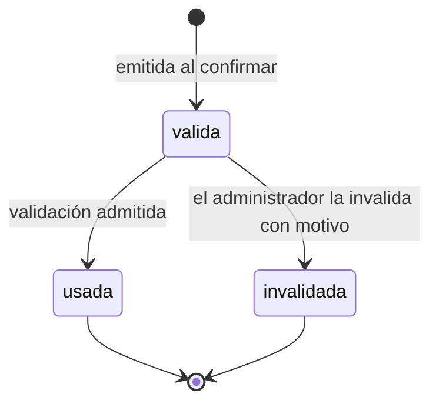

# Data Model: Carrito, compra y control de entradas

Base `participacion` (servicio de participación). Los identificadores de función y de persona son los de programación e identidad: aquí solo se guardan como texto, sin claves foráneas a otras bases. Los importes van en **centavos de USD** (enteros). Las fechas y horas se guardan en ISO UTC y se presentan en hora de Loja.

## Tablas

### `settings` (una sola fila)

| Campo | Tipo | Regla |
|---|---|---|
| `hold_minutes` | entero > 0 | Plazo de retención. Valor inicial 10 (P-07). Solo el administrador lo cambia (FR-012) |
| `sale_close_minutes` | entero ≥ 0 | Minutos antes del inicio en que se cierra la venta. Valor inicial 30 (FR-039) |
| `updated_at`, `updated_by` | | Quién hizo el último cambio |

### `sales` (configuración de venta por función)

| Campo | Tipo | Regla |
|---|---|---|
| `function_id` | texto, PK | Función de programación |
| `capacity` | entero ≥ 0 | Cupo. No puede bajar de vendidas + retenidas vigentes (FR-021) |
| `enabled` | booleano | Venta interna habilitada. Solo se activa si la actividad es de pago con precio (FR-019) |
| `updated_at`, `updated_by` | | |

Esta fila se bloquea (`FOR UPDATE`) al crear pedidos y al cambiar el cupo.

### `orders` (pedidos)

| Campo | Tipo | Regla |
|---|---|---|
| `id` | texto, PK | |
| `user_id` | texto | Dueño (identidad). Solo él lo ve (FR-017) |
| `status` | `pending`, `confirmed`, `failed`, `expired`, `in_review` | Ver transiciones |
| `total_cents` | entero | Total validado al crearse (FR-008) |
| `created_at`, `expires_at` | | `expires_at = created_at + hold_minutes` vigente al crear |
| `closed_at` | | Cuándo dejó de estar pendiente |

### `order_items`

| Campo | Tipo | Regla |
|---|---|---|
| `order_id`, `function_id` | PK compuesta | |
| `quantity` | entero 1..6 | La suma del pedido ≤ 6 (FR-038) |
| `unit_price_cents` | entero > 0 | Precio vigente al crear el pedido |
| `function_title`, `function_date`, `function_start` | | Copia para mostrar el pedido aunque programación no responda; **no** se usa para decidir |

### `payments`

| Campo | Tipo | Regla |
|---|---|---|
| `reference` | texto, PK | Única: una confirmación repetida no vuelve a emitir (FR-015) |
| `order_id` | texto | |
| `result` | `confirmed`, `failed`, `confirmed_late` | |
| `received_at` | | |

### `tickets` (entradas)

| Campo | Tipo | Regla |
|---|---|---|
| `id` | texto, PK | |
| `order_id`, `user_id`, `function_id` | texto | |
| `seq` | entero | Único con `order_id`: N entradas por pedido, sin duplicar |
| `secret_hash` | texto, único | SHA-256 del secreto del QR. El secreto no se guarda |
| `code_hash` | texto, único | SHA-256 del código alternativo |
| `status` | `valid`, `invalidated` | La cancelación de la función no cambia este campo: se consulta a programación |
| `used_at`, `used_by` | | Se escriben una sola vez (FR-028) |
| `invalidated_at`, `invalidated_by`, `invalidation_reason` | | Obligatorios al invalidar (FR-037) |
| `issued_at` | | |

El secreto y el código se entregan **una vez**, al dueño, cuando consulta su entrada: se derivan con HMAC de una clave del servicio (`TICKET_KEY`) y el id de la entrada, de modo que el servidor puede volver a mostrarlos sin guardarlos en claro.

### `access_controls`

| Campo | Tipo | Regla |
|---|---|---|
| `function_id` | texto, PK | |
| `open` | booleano | Solo se admite con `open = true` (FR-023) |
| `changed_at`, `changed_by` | | |

### `incidents`

| Campo | Tipo | Regla |
|---|---|---|
| `id` | texto, PK | |
| `order_id` | texto | Pedido en `in_review` |
| `kind` | `late_payment` | |
| `status` | `open`, `resolved` | |
| `resolution`, `resolved_at`, `resolved_by` | | La resolución no emite entradas, no recupera cupos ni reembolsa (FR-022) |

### `history` (solo anexar)

Quién, cuándo, acción, entidad y detalle de: cambios de ajustes, configuración de venta, pedidos creados y cerrados, pagos, entradas emitidas, usadas e invalidadas, aperturas y cierres de acceso, incidencias. Triggers impiden UPDATE, DELETE y TRUNCATE (RC-06).

## Estados

### Pedido

### Entrada

«Función cancelada» no es un estado guardado: se muestra cuando programación informa la función como cancelada.

## Cálculos

- **Retenidas vigentes** de una función = suma de `quantity` de pedidos `pending` con `expires_at` > ahora y función no cancelada.
- **Vendidas** = entradas de la función (cualquier estado: una invalidada no repone cupo, FR-037).
- **Disponible** = `capacity` − vendidas − retenidas vigentes.
- **Estado de venta** (FR-041): `closed` si ya pasó el cierre de venta (ahora ≥ inicio − `sale_close_minutes`) o la función está cancelada; si no, `sold_out` si disponible ≤ 0; si no, `available`.
- **Impacto** (FR-042): `soldTickets` = entradas `valid` no usadas; `pendingOrders` = pedidos con retención vigente que incluyen la función.
