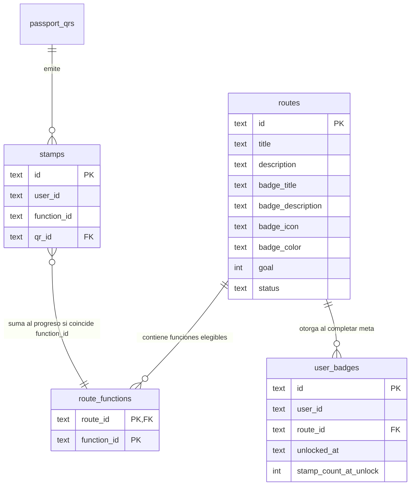

# Data Model: Rutas culturales e insignias

Amplía la base de datos del **servicio de participación** (base `participacion`, PostgreSQL 17). Los modelos anteriores están en [`specs/005-compra-y-entradas/data-model.md`](../005-compra-y-entradas/data-model.md) y [`specs/006-pasaporte-y-sellos/data-model.md`](../006-pasaporte-y-sellos/data-model.md). Las modificaciones se aplican al arrancar con sentencias idempotentes y **no borran datos**. Los identificadores de función y de persona provienen de programación e identidad (sin claves foráneas entre bases distintas).

---

## 1. routes (rutas culturales)

| Campo | Tipo | Restricciones / Reglas |
|---|---|---|
| id | texto | Clave primaria (`route_...`) |
| title | texto | Obligatorio, de 3 a 120 caracteres |
| description | texto | Obligatorio, de 10 a 500 caracteres |
| badge_title | texto | Obligatorio, de 3 a 80 caracteres (nombre de la insignia) |
| badge_description | texto | Obligatorio, de 5 a 280 caracteres (descripción del mérito) |
| badge_icon | texto | Obligatorio, uno de: `teatro`, `musica`, `danza`, `artes-vivas`, `patrimonio`, `estrella`, `brujula` |
| badge_color | texto | Obligatorio, uno de: `violeta`, `atardecer`, `terracota`, `esmeralda` |
| goal | entero | Obligatorio, `CHECK (goal > 0)`. No puede ser mayor al número de funciones elegibles al guardar |
| status | texto | `CHECK (status IN ('draft', 'published'))`, por defecto `'draft'` |
| created_at | texto | Instante ISO UTC |
| created_by | texto | ID del administrador creador |
| updated_at | texto | Instante ISO UTC |
| updated_by | texto | ID del administrador que realizó el último cambio |

**Reglas:**
- Publicar una ruta exige que `status = 'published'`, que tenga al menos una función elegible asociada y que `goal <= COUNT(funciones_elegibles)`.
- Editar una ruta publicada no retira ni revoca insignias ya ganadas (FR-006).

---

## 2. route_functions (funciones elegibles de cada ruta)

| Campo | Tipo | Restricciones / Reglas |
|---|---|---|
| route_id | texto | Clave foránea `REFERENCES routes(id) ON DELETE CASCADE` |
| function_id | texto | ID de la función en programación (nunca una franja) |
| added_at | texto | Instante ISO UTC |
| added_by | texto | ID del administrador |

**Clave primaria compuesta:** `PRIMARY KEY (route_id, function_id)`.  
**Índices:** `CREATE INDEX IF NOT EXISTS route_functions_funcion ON route_functions (function_id);`

**Reglas:**
- Solo funciones con Pasaporte habilitado (`passport_enabled = true`) en programación pueden ser añadidas (FR-002).
- Las franjas horarias de actividades no pueden ser elegibles.

---

## 3. user_badges (insignias ganadas por personas)

| Campo | Tipo | Restricciones / Reglas |
|---|---|---|
| id | texto | Clave primaria (`ubadge_...`) |
| user_id | texto | ID de la persona (identidad) |
| route_id | texto | Clave foránea `REFERENCES routes(id) ON DELETE RESTRICT` |
| unlocked_at | texto | Instante ISO UTC en que se alcanzó la meta |
| stamp_count_at_unlock | entero | Número de sellos distintos con los que se desbloqueó (`CHECK (stamp_count_at_unlock > 0)`) |

**Restricción única:** `UNIQUE (user_id, route_id)`.  
Garantiza que ningún usuario reciba dos veces la insignia de una misma ruta, aun bajo peticiones concurrentes (RC-05, RNF-06, SC-004).  
**Índices:** `CREATE INDEX IF NOT EXISTS user_badges_persona ON user_badges (user_id);`

---

## 4. Datos y estados derivados (calculados en tiempo de ejecución)

| Entidad / Dato | Fórmula / Cálculo |
|---|---|
| **Progreso personal** | `COUNT(DISTINCT s.function_id)` donde `s.user_id = $1` y `s.function_id IN (SELECT function_id FROM route_functions WHERE route_id = $2)`. |
| **Denominador** | `"${progreso} de ${route.goal}"`. Solo se muestra por ruta y nunca como meta global en Mi pasaporte (M-01, FR-015). |
| **Función con sello** | En el detalle de la ruta, cada función elegible se marca como obtenida si el usuario posee un registro en `stamps` para esa `function_id`. |
| **Ruta en revisión** | Sea $F_{\text{activas}}$ el subconjunto de funciones elegibles cuya función en programación no tiene estado `cancelled`. Si $|F_{\text{activas}}| < \text{route.goal}$, la ruta tiene el indicador dinámico `in_review: true`. La meta no se decrementa automáticamente (FR-020). |
| **Insignia ganada** | Booleano `unlocked: true/false`, presente si existe un registro en `user_badges` para `(user_id, route_id)`. |

---

## 5. Historial (tabla `history`, de solo anexar)

Cada mutación relevante sobre rutas o insignias inserta una fila inmutable en `history` (RC-06):

| Acción | `entity_type` | `entity_id` | `details` |
|---|---|---|---|
| `route.created` | `route` | `route.id` | `{ title, goal, functions_count, badge_title, status }` |
| `route.updated` | `route` | `route.id` | `{ title, goal, functions_count, status, changes: [...] }` |
| `badge.unlocked` | `badge` | `user_badge.id` | `{ user_id, route_id, stamp_count, unlocked_at }` |

---

## 6. Diagrama de relaciones

